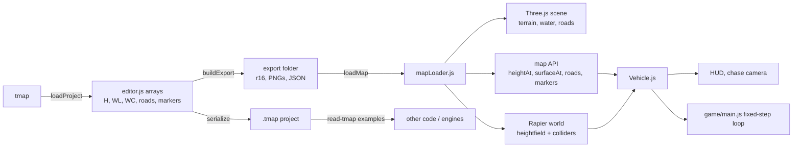

# Architecture and testing

Last verified: 2026-11-09 · three 0.187.0 · @dimforge/rapier3d-compat 0.21.0 · Node 24.14.0

Module map, data flow, the Node test suites, and where to extend the project.

## Contents

- [Module map](#module-map)
- [Data flow](#data-flow)
- [Pages and entry points](#pages-and-entry-points)
- [Tests](#tests)
- [Adding a test map](#adding-a-test-map)
- [Extending](#extending)

## Module map

### Entry points and shared code

| File | What it does |
|---|---|
| `index.html` + `src/main.js` | developer map viewer: load a map folder, debug toggles, collider and raycast checks, fly camera |
| `editor.html` + `src/editor/editor.js` | terrain/road/marker editor, undo, autosave, export, `.tmap` save/open |
| `src/editor/preview3d.js` | live 3D preview built on the game loader, throttled region updates |
| `garage.html` + `src/garage/garage.js` | car grid from `cars.json`, sprite cards, selection |
| `play.html` + `src/game/main.js` | game bootstrap, fixed-step loop, spawn, vehicle, camera, HUD, tuning |
| `src/ui/ui.css` | shared Kenney-based menu look |
| `src/ui/sfx.js` | tiny UI sound helper |
| `src/vehicles/hud.css` | HUD panels (shares `ui.css`) |
| `src/garage/garage.css` | garage layout |

### World loader (`src/world/`)

| File | What it does |
|---|---|
| `mapLoader.js` | PNG/`.r16` decoding, height/splat/water grids, terrain chunks, water meshes, Rapier heightfield, public map API, live updates |
| `roads.js` | polyline sampling, junction detection, terrain stamping, road/bridge/roundabout meshes, analytic road query |
| `roadMeta.js` | enums, defaults, node/map metadata parsing, city/highway/self-junction constants |
| `roadEdges.js` | fences, guardrails, barriers, lamps, bump, rumble, roadworks |
| `roadSigns.js` | curve/hill/winding detection, sign placement and instancing |
| `roadCity.js` | city corridor runs, footpaths, kerbs, corner blocks, crosswalks |
| `roadSignals.js` | signal posts, stop lines, zebras, railings, phase cycle |
| `cityBlocks.js` | city blocks + lots + plazas from the road graph (zones residential / rowhouse / downtown), `blocked()` for the scatter |
| `cityChunk.js` | per-128 m chunk planner: houseKit / rowKit / towerKit buildings merged per material (near) + impostors (far), colliders, plinths |
| `cityFill.js` | city renderer: lazy chunk LOD under a frame budget, materials (windowAtlas, city.glb textures), plaza props, `cityColliders.js` pool |
| `roadBridges.js` | automatic bridges over lakes, rivers and the ocean |
| `roadGeo.js` | shared instancing and geometry helpers |
| `sceneEnv.js` | renderer, sky, sun, fog (browser helper, not used by the loader) |
| `markerPins.js` | canvas marker pins for the dev viewer (browser helper) |

### Vehicles (`src/vehicles/`)

| File | What it does |
|---|---|
| `Vehicle.js` | Rapier vehicle controller, suspension, steering, forces, surface queries, visual sync |
| `handling.js` | archetypes, per-car overrides, profile resolution, tunable ranges |
| `chaseCamera.js` | chase and hood cameras, springs, ground clamp, FOV, shake |
| `cameraLook.js` | pure free-look maths, recentre, persistence |
| `tuningPanel.js` | lil-gui panel, copy profile JSON |
| `hud.js` | speed, gear, surface, hints, debug line |
| `input.js` | keyboard + gamepad + pointer lock |
| `carCatalog.js` | fetch `cars.json`, remember the selected car |
| `wedge.js` | test ramp geometry and collider |

## Data flow



Export is the interchange format: the editor never imports the loader. The
preview converts its arrays with the same code path as export and calls
`loadMapFromData`, so preview and game agree.

## Pages and entry points

| Page | Module | Behaviour |
|---|---|---|
| `/index.html` | `/src/main.js` | dev viewer; `?map=` folder, debug toggles, physics and raycast tests |
| `/editor.html` | `/src/editor/editor.js` | editor; autosave prompt on start |
| `/garage.html` | `/src/garage/garage.js` | car selection; Drive link to `play.html?car=` |
| `/play.html` | `/src/game/main.js` | game; `?map=`, `?car=`, `?spawn=`, `?testRamp` |

Vite builds all four (`vite.config.js` `build.rollupOptions.input`). The dev
server binds `127.0.0.1` and uses the default port 5173. `public/` is served as
the default public directory, and `@dimforge/rapier3d-compat` is excluded from
dependency pre-bundling.

## Tests

There is no aggregate `test` script. Run the suites individually.

| Script | File | What it checks |
|---|---|---|
| `npm run test:loader` | `scripts/test-loader.mjs` | PNG decode equals `.r16`; splat weights sum to 255; terrain mesh vertices equal `heightAt`; Rapier raycasts hit the heightfield with a low mean error; `waterLevelAt` equals lake mesh height; splines pass through control points; `surfaceAt` weights sum to 1; `normalAt` is unit; `loadMapFromData` equals `loadMap`; markers and queries; `updateRegion` equals a full rebuild; `physics:false` creates no collider. `--map junctions` adds the junction block (roundabout/plain junction, overpass, stamping, island collider). |
| `npm run test:roads` | `scripts/test-roads.mjs` | warning signs (curve/sharp/winding/hill, 55 m placement, side, facing, driveSide left, `signStyle eu`, city/off/bridge/junction suppression, one-way); edge colliders and spacing; bumps, rumble, roadworks, crosswalk; surface values and grip; one-way decals; metadata round-trip; enum fallback; old-map back-compat; `roadmeta` map covers every sign, edge and feature; `updateRegion` with edited metadata equals a rebuild. |
| `npm run test:city` | `scripts/test-city.mjs` | junction style defaults and precedence (markers, `junctions.json`, `none`); self-meetings (figure-eight, lollipop, closed loop, hairpin, tight curve, 15°/40° crossings, overpass); city footpaths, corner blocks, kerbs, zebras, signals, median barrier; `citytest` map expectations; corridor stamping on flat and hilly terrain; Rapier agreement; live edits; old maps. |
| `npm run test:citychunk` | `scripts/test-city-chunk.mjs` | chunk planner on `city` / `citytest`: determinism (any chunk order), every lot planned once, impostor <= 30 tris, colliders; prints tris / draws / ms per chunk. (Also `node scripts/test-city-blocks.mjs`, `test-house-kit.mjs`, `test-city-kits.mjs`.) |
| `npm run test:bridges` | `scripts/test-bridges.mjs` | one auto bridge over a lake, river and ocean; deck clearance and grade; ramp ends at dry height; smoothness; deck collider; terrain under the deck intact; no edges/features/signs on the bridge; `autoBridge:false` restores the old drape; city roads lose footpaths on a bridge; tiny wet spots and merge distances; junction skips; marked bridges raised; flood/drain/setSeaLevel live rebuilds; a sedan drives across. |
| `npm run test:vehicles` | `scripts/test-vehicles.mjs` | see [vehicles-and-cars.md](vehicles-and-cars.md#tests). Options `--quick`, `--cars`, `--road-only`, `--smoke-only`. |
| `npm run city-map` | `scripts/make-city-test-map.mjs` | regenerates `public/maps/citytest/` from `junctions/` (roads and markers only) |
| `npm run cars` | `scripts/cars/run.mjs` | Blender FBX → GLB and preview sheet (needs Blender) |

The Node suites run the loader headless by monkey-patching `globalThis.fetch` to
read `public/maps/<dir>/` from disk, importing `three` and Rapier as normal ESM,
and calling `await RAPIER.init()` before creating a world. The vehicle suite also
parses GLB JSON chunks for body bounds and stubs `heightAt`/`surfaceAt` to isolate
grip.

Run them before changing the loader or road code:

```bash
npm run test:loader
npm run test:roads
npm run test:city
npm run test:bridges
npm run test:vehicles -- --quick
```

## Adding a test map

Two routes:

### Node generator (like `citytest`)

1. Pick a source map for terrain and settings, for example
   `public/maps/junctions/`.
2. Write `scripts/make-my-map.mjs` following
   `scripts/make-city-test-map.mjs`: copy every file except `roads.json` and
   `markers.json`, read `map.json`, ensure `files.markers`, read
   `heightmap.r16` and reimplement bilinear `heightAt` for road `y` values, write
   the new JSON with 1-space indentation.
3. Run it with `node scripts/make-my-map.mjs` (optionally add an npm script).
4. Add assertions to a test suite or a new `scripts/test-*.mjs`.

### Editor

1. Build the map in `/editor.html`.
2. Export to a folder (Chromium folder picker).
3. Copy it to `public/maps/<name>/`.

Both routes produce the same file set; see
[file-formats.md](file-formats.md#minimal-valid-map).

## Extending

### New surface class

The format is fixed at eight classes: `map.json` `classes` must have exactly 8
entries, and the two splat PNGs have four channels each. Adding a ninth class is
a format change. The files to touch:

- `src/world/mapLoader.js`: `SURFACE_NAMES`, `SURFACE_FRICTION`, splat decoding,
  the terrain shader's class colours and road-class removal.
- `src/world/roadMeta.js`: surface-class assumptions if the new class affects
  roads.
- `src/editor/editor.js`: `CLASSES`, `CR/CG/CB`, paint palette, auto-paint rules,
  export buffer count.
- `docs/file-formats.md`: class table.
- `scripts/test-*.mjs`: splat-sum and class assertions.

For a new **road surface** (not a terrain class), extend `SURFACES`,
`SURFACE_PROPS`, the road shader branch, the editor's surface select, and the
surface tests. That does not change the file format beyond a new enum value.

### New road point feature

- `src/world/roadMeta.js`: add to `FEATURES`.
- `src/world/roadEdges.js`: build geometry and collider in `collectFeatures` /
  the feature builder, and update `stats.features`.
- `src/world/roads.js`: include it in the detail counts and any placement rules.
- `src/editor/editor.js`: add the checkbox in `buildNodeUI` and the badge in
  `FEAT_UI` / `drawRoadMeta`.
- `docs/roads-and-junctions.md` and `docs/file-formats.md`: document it.
- `scripts/test-roads.mjs`: assert geometry, collider and `roadDetail`.

### New junction style

- `src/world/roadMeta.js`: add to `JUNCTION_STYLES`.
- `src/world/roads.js`: style decision in `detectJunctions`, geometry builder
  next to the patch/roundabout/signals code, extent/blend and mask handling.
- `src/world/mapLoader.js`: validation accepts the new `junctions.json` style.
- `src/world/roadMeta.js`: marker tag mapping if it should be marker-forced.
- `src/editor/editor.html`: help text.
- `scripts/test-city.mjs`: style rules and geometry.
- `docs/roads-and-junctions.md`: precedence and constants.

### New car archetype

- `src/vehicles/handling.js`: add `ARCHETYPES.<name>`, map car ids in
  `CAR_ARCHETYPE`, add any `TUNABLE` keys the panel should expose.
- `scripts/test-vehicles.mjs`: add target bands and ratio assertions.
- `docs/vehicles-and-cars.md`: archetype table.
- Optionally add a `CAR_OVERRIDES` entry for a specific car.

### New car asset

Follow [vehicles-and-cars.md](vehicles-and-cars.md#adding-a-car). No source edit
is needed unless the car needs an override or a new archetype.
