# Gallery

Screenshots of the engine on the two generated showcase maps (`public/maps/showcase-city`, `public/maps/showcase-nature`, built by `scripts/make-showcase-maps.mjs`).

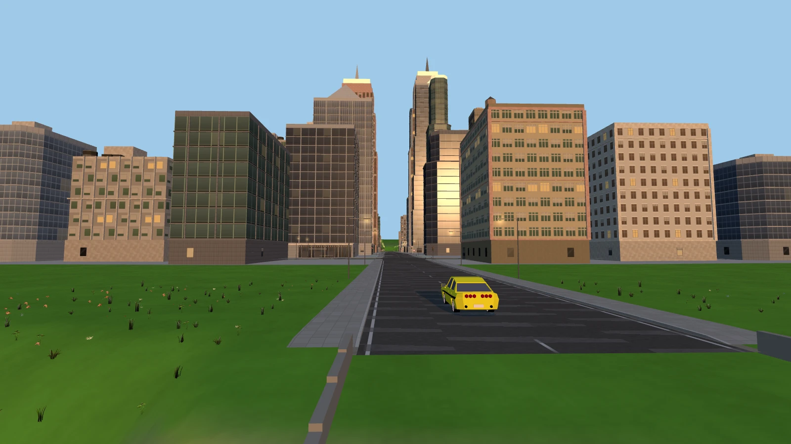

| | |
|---|---|
| 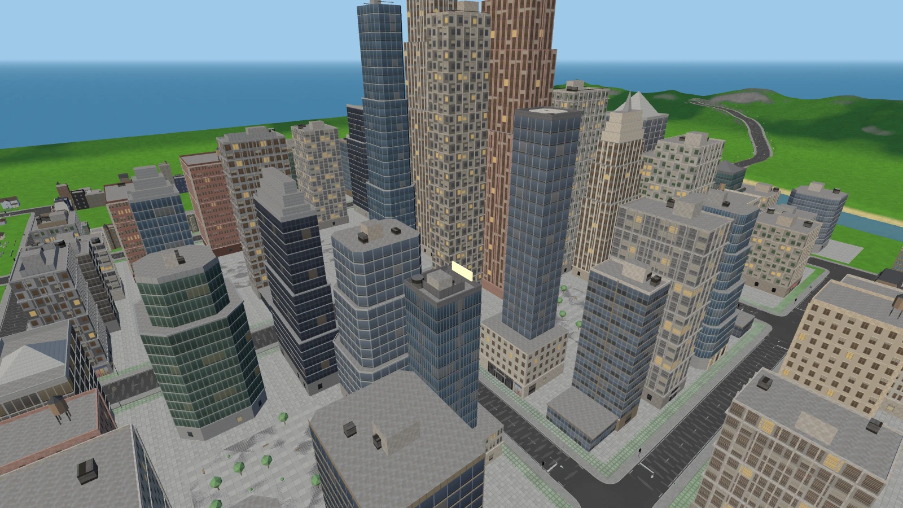 **Downtown from above** - procedural towers, setbacks, crowns and plaza paving. | 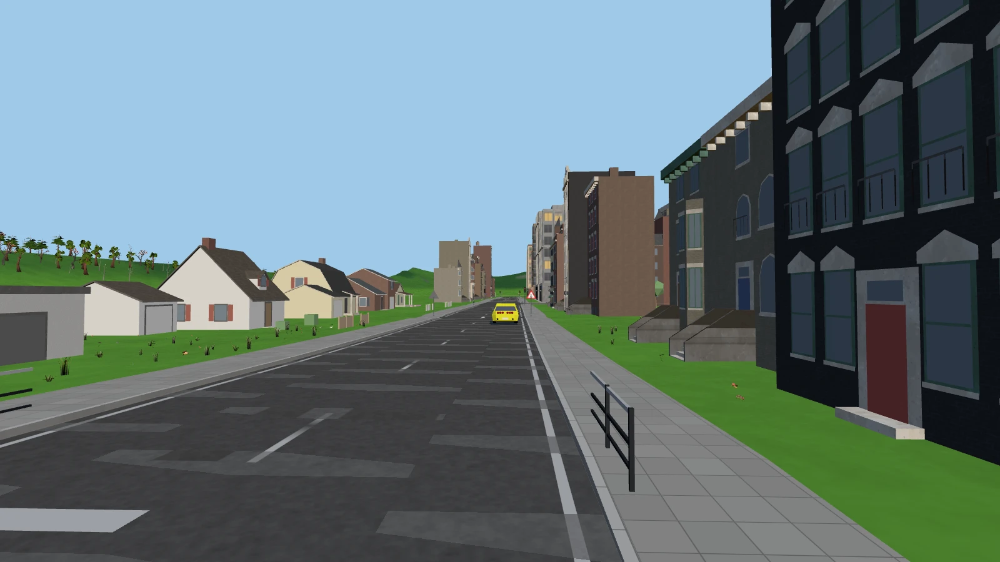 **Rowhouse terrace** - attached rowhouses on one side, suburban houses on the other. |
| 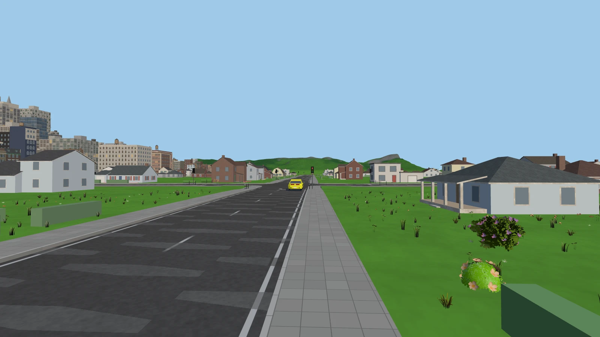 **Suburbs** - detached houses with lawns, driveways and hedges, downtown on the horizon. | 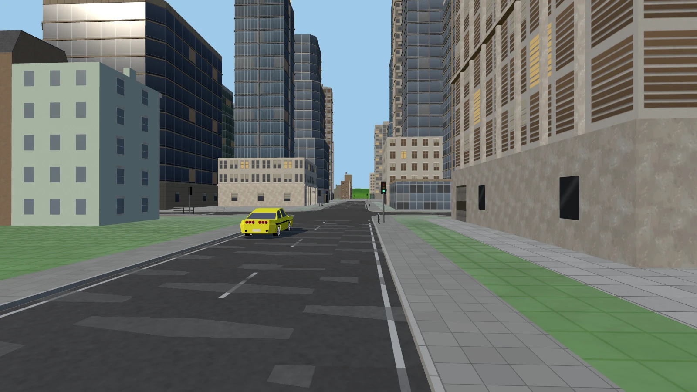 **Signalled junction** - signals, stop lines, footpaths and lamps at car height. |
| 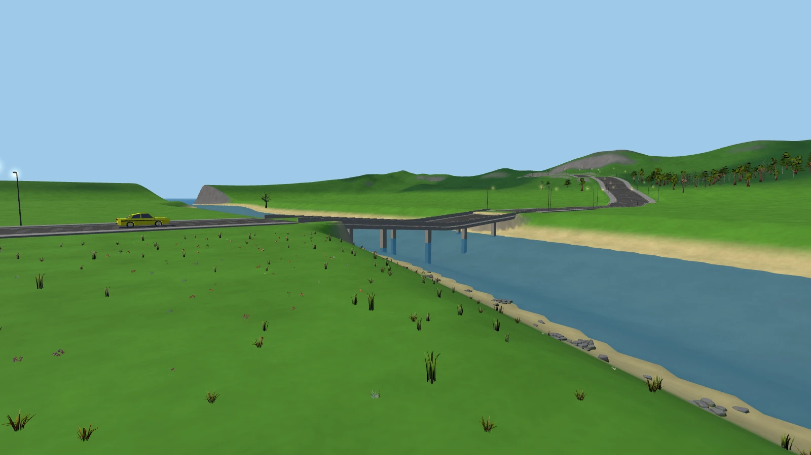 **River and bridge** - the avenue crosses the river on an automatic bridge. | 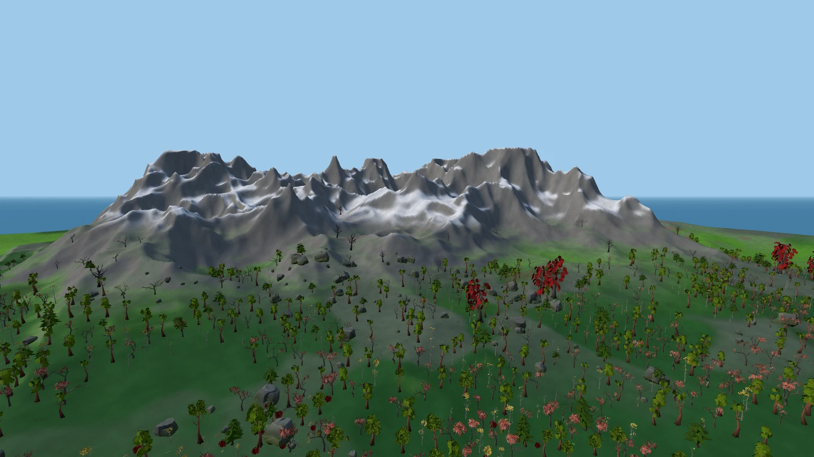 **Mountains** - rock, snow caps and forest from the painted surface classes. |
| 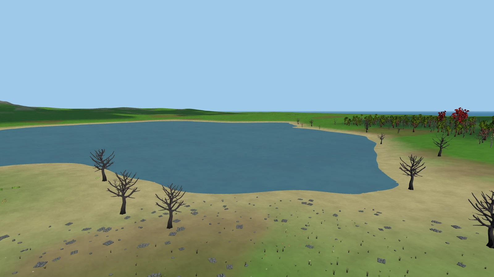 **Lake and beach** - a sand band follows the shoreline. | 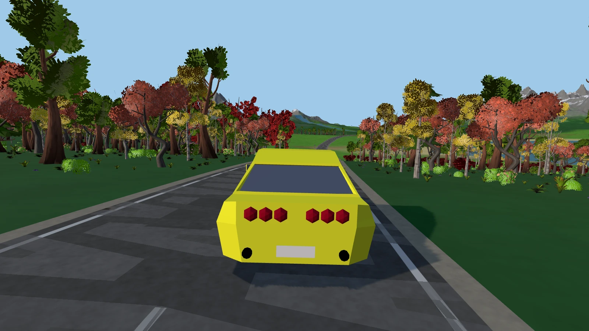 **Country road** - chase camera on a winding road through autumn forest. |
| 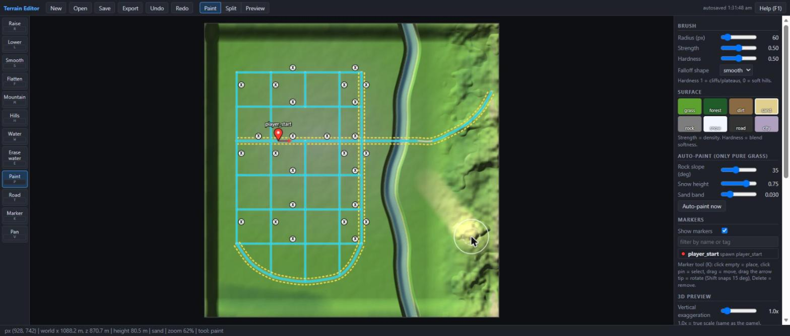 **Editor** - paint brush, road overlay with crosswalks and lamps, markers. | 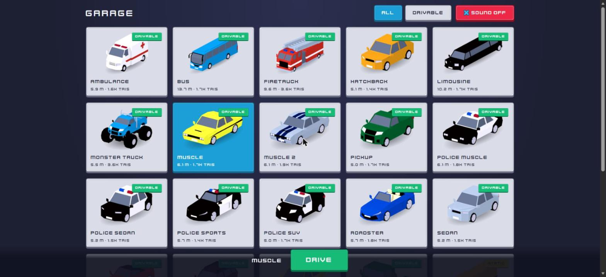 **Garage** - car selection sheet. |
| 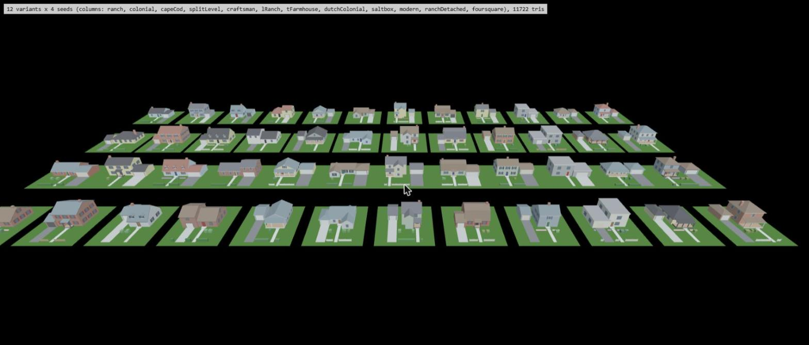 **House kit** - 12 styles x 4 seeds from `house-preview.html`. | |

## Regenerate

1. `node scripts/make-showcase-maps.mjs` (rebuilds both maps; add `--tmap` for an editor project file).
2. `bun run dev` and `node scripts/shot-server.mjs` (saves POSTed images to this folder, port 5188).
3. For each in-game entry of `scripts/shots.json`, open `http://127.0.0.1:5173/play.html?map=/maps/<map>/&<params>`, wait until `__game.city.stats().pending === 0` (and the scatter is ready), then in the console:
   ```js
   const url = __game.shot(1600, 900);   // renders at that size, restores the window size
   await fetch('http://127.0.0.1:5188/save?name=01-hero.webp', { method: 'POST', body: url });
   ```
4. `screenshot` entries (editor, garage, house preview) are plain browser screenshots at about 1600 px wide.

Camera params (dev only, no effect without them): `cam=x,y,z`, `look=x,y,z`, `fov=deg`, `hideUI=1`, `sun=elevDeg,azimDeg` (azimuth 0 = light from +Z, 90 = from +X; below ~20 degrees it turns warm), `spawn=x,z,yawDeg`.
